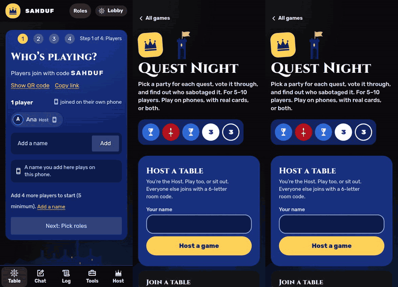

# Quest Night

A hidden-loyalty party game for 5 to 10 people in the same room, played on their own phones with no moderator.

**Play it: [avalon.hatethespurs.com](https://avalon.hatethespurs.com)**
[](https://avalon.hatethespurs.com)


<p align="center">
  
</p>

## Features

- **Quick to learn.** A rotating leader picks a party, everyone votes, and the party secretly plays Success or
  Sabotage on three-of-five quests while a hidden Evil team tries to stay unnoticed.
- **One phone each, no moderator.** The host makes a room, players join with a six-letter code or a QR code, and
  the app deals roles, runs votes and quests, and checks every win condition.
- **Secrets stay on the server.** Each phone gets its own view of the game, so hidden roles and who played which
  quest card never reach a phone that should not see them.
- **Optional roles.** Merlin and the Assassin, Percival, Morgana, Mordred and Oberon, each seeing exactly what the
  rules allow.
- **Classic rules handled for you.** Quest sizes by table size, the two-Sabotage rule on quest 4 at 7+ players,
  five rejected parties as an Evil win, and the Assassin's strike at Merlin.
- **Phone, physical or hybrid play.** Roles, votes and quest cards can each run in the app or with real cards. A
  printable card guide is included.
- **Host tools.** Unlimited Undo and Redo, pause, replace or skip an absent player, hand off the host role, and a
  shared table screen for a TV.
- **Reconnect-safe.** A phone that drops or locks gets back the same seat, card and vote.
- **Installable and offline-ready.** A service worker caches the app shell, and the screen stays awake during play.

Sister app to [Mafia Night](https://mafia.hatethespurs.com).

## Stack

- JavaScript (ES modules), vanilla JS and CSS on the client, no framework and no build step.
- Cloudflare Workers with one SQLite-backed Durable Object per room, using the WebSocket Hibernation API.
- Workers Static Assets serve `public/`. Idle rooms are cleared by a 12-hour alarm.
- PWA: web app manifest and a service worker whose cache version is a content hash of `public/`.
- Wrangler 4 (the only dependency) and Node's built-in test runner.

## Run locally

Requires Node 22 or newer. No Cloudflare account is needed.

```sh
npm ci
npm run dev          # wrangler dev --local, serves http://localhost:8787
```

Open the URL in a few browser windows, or on phones on the same network, to play a room.

## Tests

```sh
npm test             # 354 unit and integration tests (353 pass, 1 skipped), about 11 seconds
```

The suite covers the rules, the reducer, secrecy in every phase, Undo and Redo, the realtime fan-out, the PWA cache
version and the deploy config. [RULES.md](RULES.md) maps each house rule to the test that guards it.

Whole-game simulation against a running server, and browser tests that drive several phones in Chromium:

```sh
BASE=http://localhost:8787 GAMES=40 SEED=1 node scripts/sim-games.mjs   # must end with problems: 0
PW=/path/to/node_modules/playwright-core CHROME=/path/to/chrome npm run e2e
```

## Project structure

```
src/worker.js           Worker routes (/api/create, /ws/<code>) and the Room Durable Object
src/fanout.js           sends each connected socket its own view after every action
public/js/rules.js      pure rules: table sizes, quest sizes, the two-fail rule, role deal, who sees whom
public/js/room.js       the reducer for every action, plus the per-player views (all secrecy lives here)
public/js/table.js      seats, play modes, house rules, chat and host controls
public/js/event-log.js  the room as an event log; replaying it rebuilds the room (Undo and Redo)
public/js/app.js        the client: routing, the socket, every screen
public/sw.js            service worker for the installable, offline app shell
scripts/                service-worker stamp, deploy checks, game simulator
test/                   node --test suites; test/e2e/ has the multi-phone browser tests
docs/                   deploying guide, logic audit, workflow files
```

The server is the only source of truth: phones send actions, and the reducer validates them. Each event stores its
own random seed, so replaying the log always gives the same room. Views are computed per player, so hidden roles,
quest-card owners and host keys never leave the server.

## Deploying

`npm run deploy` runs `wrangler deploy` with `CLOUDFLARE_API_TOKEN` and `CLOUDFLARE_ACCOUNT_ID` set. GitHub Actions
workflows are kept in `docs/github-workflows/`. See [docs/deploying.md](docs/deploying.md) for the details.

## More screenshots

<p>
  
  
  
</p>

## Credits

- Crown, chalice, lantern and crest icons drawn for Quest Night.
- Role icons from [game-icons.net](https://game-icons.net) by Lorc, Delapouite and contributors (CC BY 3.0).
- Interface icons from [Phosphor](https://phosphoricons.com) (MIT).
- Fonts: Rubik, Cinzel, Alegreya and Alegreya Sans (SIL Open Font License 1.1). See `public/fonts/` and
  [scripts/fonts/README.md](scripts/fonts/README.md).
