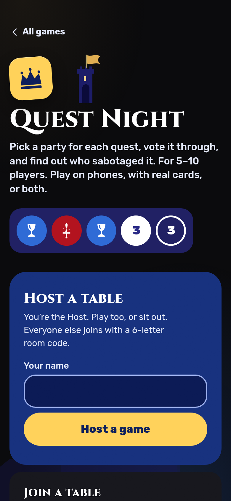
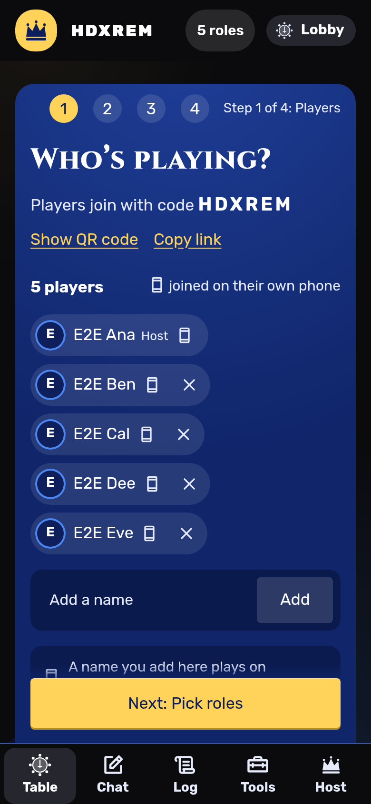
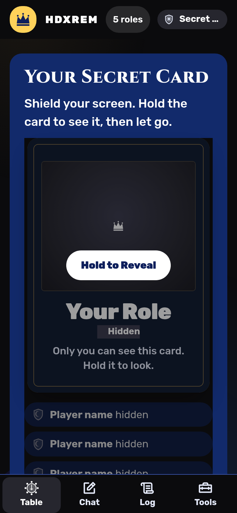

# Quest Night

Quest Night is a hidden-loyalty party game for 5 to 10 people in the same room, played on their phones with no
moderator: a rotating leader picks a party, everyone votes, and the party secretly plays Success or Sabotage on
three-of-five quests while a hidden Evil team tries to stay unnoticed. It is a sister app to
[Mafia Night](https://mafia.hatethespurs.com). On the engineering side, each room is a single server-authoritative
Cloudflare Durable Object that keeps the game as a replayable event log and sends every phone its own projection of
the state, so no secret ever reaches a phone that should not see it. The client is an installable offline PWA, and a
test suite of rules, secrecy and whole-game simulations guards the game logic.

**Live:** https://avalon.hatethespurs.com

<p>
  
  
  
</p>

## Features

- **One phone each, no moderator.** The host makes a room, players join with a six-letter code or QR code, and the
  app deals the roles, runs the votes and quests, and checks every win condition.
- **Optional roles.** Merlin and the Assassin as a pair, plus Percival, Morgana, Mordred and Oberon. Each role sees
  exactly what it should: Merlin sees Evil except Mordred, and Percival sees Merlin and Morgana in a random order.
- **Classic rules handled for you.** Quest sizes by table size, the two-Sabotage rule on quest 4 at 7+ players, five
  rejected parties in a row as an Evil win, and the Assassin's strike at Merlin after three successful quests.
- **Phone, physical or hybrid play.** Roles, votes and quest cards can each run in the app or with real cards. A
  printable card guide and card sheet (PDF) are included.
- **Host tools that never dead-end.** Unlimited Undo and Redo, pause, replace or skip an absent player, hand off
  the host role, and an optional Lantern card. Tables also get timers, a coin, dice and a shared table screen.
- **Reconnect-safe.** A phone that drops or locks gets back the same seat, card and vote.
- **Installable and offline-ready.** A service worker caches the app shell, and the screen stays awake during play.

## Stack

- **Language:** JavaScript (ES modules), no build step for the client.
- **Server:** Cloudflare Workers, one Durable Object per room (SQLite-backed) using the WebSocket Hibernation API,
  with a 12-hour alarm that clears idle rooms.
- **Static files:** Workers Static Assets from `public/`, with a styled 404 page.
- **Client:** vanilla JS and CSS, no framework. Hash routing, a live WebSocket, and a built-in QR encoder.
- **PWA:** web app manifest and a service worker whose cache version is a content hash of `public/`.
- **Tooling:** Wrangler 4 (the only dependency) and Node's built-in test runner.

## How it works

```
public/js/rules.js      pure rules: table sizes, quest sizes, the two-fail rule, role deal, who sees whom
public/js/room.js       the reducer for every action, plus viewForPlayer / viewForScreen (all secrecy lives here)
public/js/table.js      table layer: seats, play modes, house rules, chat, host controls, table tools
public/js/event-log.js  the room as an event log; replaying it rebuilds the room, which is how Undo/Redo work
src/worker.js           Worker routes (/api/create, /ws/<code>) and the Room Durable Object
src/fanout.js           sends each connected socket its own view after every action
public/js/app.js        the client: routing, the socket, every screen
```

- The server is the only source of truth. Phones send actions, and the reducer validates them.
- Each event stores its own random seed and timestamp, so replaying the log always gives the same room.
- Views are computed per viewer, so hidden roles, quest-card owners and host keys never leave the server.

## Run locally

Requires Node 22 or newer (CI uses Node 24). No Cloudflare account is needed.

```sh
npm ci
npm run dev          # wrangler dev --local, serves http://localhost:8787
```

Open the URL on a few browser windows or phones on the same network to play a room.

## Tests

```sh
npm test             # 354 unit and integration tests, about 12 seconds
```

The suite covers the rules, the reducer, secrecy in every phase, Undo/Redo, the realtime fan-out, the FAQ against
the rules, the PWA cache version, fonts, and deploy config. [RULES.md](RULES.md) maps each house rule to the test
that guards it, and [AUDIT.md](AUDIT.md) records the logic audit.

Whole-game simulation against a running server (scripted players, no browser):

```sh
BASE=http://localhost:8787 GAMES=40 SEED=1 node scripts/sim-games.mjs   # must end with problems: 0
```

Browser end-to-end tests drive several phones in Chromium against `wrangler dev --local`. They need
`playwright-core` and Chrome, located with the `PW` and `CHROME` environment variables:

```sh
PW=/path/to/node_modules/playwright-core CHROME=/path/to/chrome npm run e2e
```

## Deploying

`npm run deploy` runs `wrangler deploy` with `CLOUDFLARE_API_TOKEN` and `CLOUDFLARE_ACCOUNT_ID` set. A manual GitHub
Actions workflow (`deploy.yml`) does the same after `npm test`; the workflow files are in `docs/github-workflows/`
until they are moved to `.github/workflows/`. See [docs/deploying.md](docs/deploying.md) for the details.

## Credits

- Crown, chalice, lantern and crest icons drawn for Quest Night.
- Role icons from [game-icons.net](https://game-icons.net) by Lorc, Delapouite and contributors (CC BY 3.0).
- Interface icons from [Phosphor](https://phosphoricons.com) (MIT).
- Fonts: Rubik, Cinzel, Alegreya and Alegreya Sans (SIL Open Font License 1.1). See `public/fonts/` and
  [scripts/fonts/README.md](scripts/fonts/README.md).
